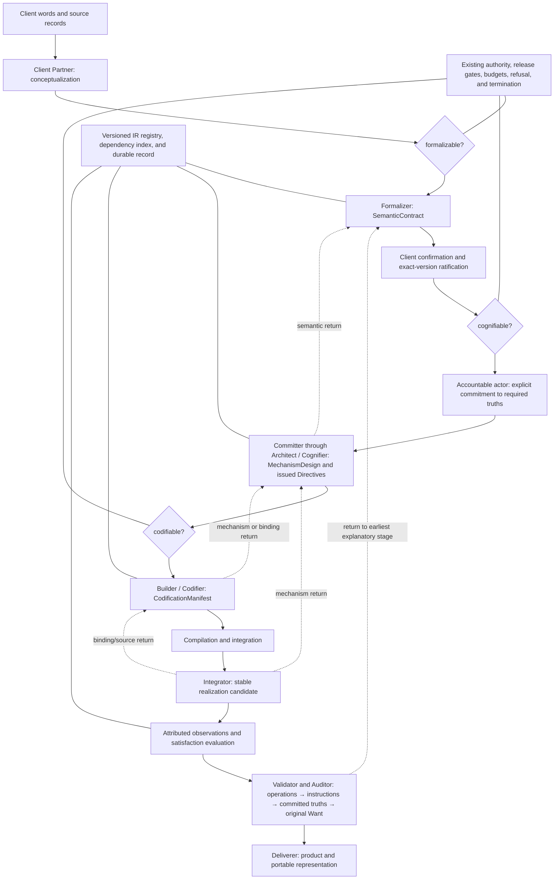

# Wantware Implementation Plan for The Agency

**Status:** In progress — P1 and P2 implemented (2026-09-22); see §11. P0 and P3–P8 not started.  
**Prepared:** 2026-09-08.  
**Grounding:** The [integration proposal](./Adding%20the%20Wantware%20Representation%20to%20the%20Agency.md), [Wantware model](./Wantware.md), [IR 0.3 specification](./WantwareIR.md), [normative schema](./WantwareIR.schema.json), and [Agency codemaps](../../codemaps/01-architecture.md), checked against selected implementation paths.  
**Repository baseline:** `569b60960ae64973c35c658f364e20b1eb5bb071`, plus the working tree inspected on the preparation date. Existing unrelated working changes are outside this plan.

## 1. The implementation outcome

Make Wantware the representation carried through the Agency's existing governed production process. A client want should have a traceable path from its original expression through evidenced current/wanted states, required truths, an accountable delivery commitment, instructions authored by that committer, executable operations, and observed fulfillment. At every boundary, the next role should know which version it may use, what remains unknown, and what evidence will establish success.

The first priority is trustworthy completion. Today several execution paths turn a clean return into passing acceptance results. We must fix that before expanding the representation into a broad ontology or generation system.

The expected improvements to the cognitive software factory are concrete:

| Factory outcome | Change that enables it | Evidence of improvement |
|---|---|---|
| Build the intended product | Preserve conception, model the client's world, and challenge adequacy before design | An omitted goal or entity is found before source is written |
| Know whether work succeeded | Separate transport, observations, warrants, and established claims | A successful handler with missing outcome evidence cannot complete acceptance |
| Repair at the right stage | Typed returns identify both the broken representation and its custodian | A semantic defect reaches the Formalizer and client instead of becoming a Builder workaround |
| Change safely and locally | Immutable parent bindings and explicit dependency indexing | An amendment identifies affected work while unrelated work remains eligible |
| Reuse and reduce runtime cognition | Match realization capabilities, then test replacements against satisfaction cases | Reuse is justified by compatible meaning; a deterministic replacement satisfies the original claims |
| Deliver a maintainable product | Ship the semantic/design basis and build/evidence manifests | A recipient can inspect, verify, and rebind the product without Agency runtime scaffolding |

These are hypotheses to measure through the calibration program, not benefits already demonstrated by the current test suite.

## 2. Architecture to build

Keep the three authority layers and the two-graph execution rule. Representation readiness is an additional prerequisite beside authority. It grants no authority of its own. The commitment and issuance nodes are proposed engagement gates; passing readiness or ratification is not a delivery commitment. Feasibility investigation may precede commitment as explicitly provisional work, without issuing implementation instructions.

Use one IR 0.3 envelope with four owned strata: source, semantic, cognitive, and materialization. `ConceptualizationPacket`, `SemanticContract`, `MechanismDesign`, and `CodificationManifest` are projections of those strata. The seven materialization stages describe advancement; they do not require seven stores or seven new roles.

The Integrator is intentionally not a fifth IR stratum owner. It consumes
immutable materialization and runtime records to turn a provisional build into a
coherent, reproducible candidate: compilation, integration, dependency
resolution, and contract runs. Deterministic-replacement proposals stay with
the Productizer, which works across engagements on the Cognition Ledger. Its
results are attributed realization evidence, not a self-issued success verdict.
Validator/Auditor evaluation establishes realized correctness against the
semantic satisfaction cases; an integration finding returns to Codifier,
Cognifier, or Formalizer according to the earliest explanatory defect.

Four sequences appear in this plan and must not be conflated:

- **Speech acts** carry the obligation from Expressive → Assertive → Declarative → Commissive → committer-authored Directive → Imperative → verified realization. They run through the representation and lifecycle stages, without adding a fifth stratum or replacing the seven materialization stages.
- **Wantware materialization stages** are the seven representational transitions from Conception through Computation.
- **Implementation packages** are P0–P8 and describe delivery order in this repository.
- **Agency lifecycle stages** are the authored operational groupings currently shown in `ACE³.html`.

The speech act flow follows [The WantWare Development Process §3.1](../../../architectures/The%20WantWare%20Development%20Process.md#31-the-speech-act-flow). Preserve the Expressive and its beneficiary in source. Assertives distinguish observed reality from assumptions, uncertainty, and the intended wanted state; wanting a state does not establish that it exists. The SemanticContract carries that context and the Declarative states, constraints, and acceptance conditions that bridge the gap. A separate Commissive binds an accountable actor to delivering those exact truths under stated scope and conditions. That actor then authors and issues Directives through the Cognifier role; a candidate MechanismDesign alone proves neither commitment nor issuance. Builder, compilation, integration, and computation turn the instructions into Imperatives. Evaluation must establish their effects against the issued instructions, committed truths, and original Want.

Deterministic contracts define inputs, state, validation, and retry/revise/escalate branches around probabilistic contributors. They cannot guarantee external conditions or accept a generated output as fulfillment. Failed checks retain the unmet obligation and return to the appropriate stage rather than redefine the Want.

Use the qualified names in code, tests, and documentation. A phrase such as “Stage 3” without its sequence is ambiguous.

Use the [AXIS Lite](../../codemaps/AXIS-Lite.md) discipline: pure validation and evaluation functions; explicit state ownership; storage and tool effects at existing adapter boundaries; collaborator assembly in `openEngagement()`. Avoid putting ontology traversal, evidence interpretation, storage, and role behavior inside `ExecutionEngine`.

### Component placement

Paths in the following tables are relative to `Agency/`. Names marked **new** are proposed files, not existing APIs.

| Responsibility | New nucleus | Existing integration points | Codemap basis |
|---|---|---|---|
| IR serialization, projections, identities, parent bindings | **new** `kernel/wantware-ir.js` | `kernel/index.js`, package exports and schema packaging | [Domain model](../../codemaps/06-domain-model.md), [public surface](../../codemaps/08-public-surface.md) |
| Immutable publication and dependency/stale projections | **new** `kernel/representation-index.js`; **new** `kernel/representation-store.js` adapter | `kernel/store.js`, `events.js`, `relationship.js`, `daemon.js`, `git-ledger.js` | [Persistence](../../codemaps/05-state-and-persistence.md), [runtime topology](../../codemaps/03-runtime-topology.md) |
| Evidence establishment | **new** `kernel/evidence.js` | `runtime.js`, `state.js`, `audit-lint.js`, `cognition/adapter.js`, `cognition/role-executor.js` | [Components](../../codemaps/04-components.md), [signature index](../../codemaps/09-signature-index.md) |
| Boundedness, closure, readiness | **new** `kernel/readiness.js`, **new** `kernel/ontology.js` | `intent.js`, `catalog.js`, `record.js`, `constitution/TIERS.json` | [Domain model](../../codemaps/06-domain-model.md), [guardrails](../../codemaps/10-guardrails-and-workflows.md) |
| Semantic authorship and ratification | **new** `roles/formalizer/` | `roles/roster.js`, Client Partner graph, `proposals.js`, authority/permissions, collaboration contracts | [Extensibility](../../codemaps/07-extensibility-and-plugins.md) |
| Commitment and Directive lineage | **new** engagement-record contract and pure lineage validator (placement settled in P0) | `proposals.js`, authenticated role dispatch, representation store, runtime/release/resume gates; separate from ratification and authority | [IR representational limits](./WantwareIR.md#212-speech-act-mapping-and-current-representational-limits) |
| Consumer gates and typed returns | Shared readiness/representation services | Architect and Builder graphs, `runtime.js`, `return-path.js`, Flow/DSL validators | [Runtime topology](../../codemaps/03-runtime-topology.md), [recomposer anchors](../../codemaps/11-recomposer-anchors.md) |
| Bounded observations during a run | **new** `kernel/scroll-live.js` | `scribe.js`, runtime dispatch, role executor | [Components](../../codemaps/04-components.md), [persistence](../../codemaps/05-state-and-persistence.md) |
| Inspect, resume, and deliver | Representation projections through existing surfaces | MCP definitions/handlers, `reflect.js`, `collaboration.js`, role briefs, tour, Deliverer | [Entry points](../../codemaps/02-entry-points.md), [public surface](../../codemaps/08-public-surface.md) |

## 3. Verified starting point and adjustments to the proposal

The maps are useful navigation guides, but some details differ from the current code. Implementation should follow verified symbols and tests rather than the maps' counts or illustrative schemas.

| Finding in the current implementation | Consequence for this plan |
|---|---|
| [`runtime.js`](../../kernel/runtime.js) synthesizes acceptance passes in `#runDeterministic`; result ingestion trusts supplied booleans and an empty result array passes `.every(...)` | Evidence work must cover both execution paths and exact acceptance coverage. Empty evidence cannot establish required claims |
| [`cognition/role-executor.js`](../../cognition/role-executor.js) also synthesizes passes on clean graph exit; [`adapter.js`](../../cognition/adapter.js) defines and produces legacy result envelopes | Fix producers and consumers together. A kernel-only change leaves another route to self-certification |
| [`state.js`](../../kernel/state.js) records supplied acceptance results; [`audit-lint.js`](../../kernel/audit-lint.js) checks legacy completion | Store observations and evaluations separately, then make completion and lint use the same establishment rule |
| [`kernel/flow/grammar-2.0.js`](../../kernel/flow/grammar-2.0.js) and its validator exist, while the runtime and package exports still use DSL 1.4 | Resolve grammar routing explicitly. Adding only the proposal's `grammar-1.5.js` would miss the existing Flow unification work |
| [`store.js`](../../kernel/store.js) uses append-only `events`, `cognition`, `human_roles`, `intent_ledger`, and `provenance` ledgers plus snapshots and relationship/initiative storage | Extend the actual store contract; the table inventory in codemap 05 is not a migration specification |
| [`relationship.js`](../../kernel/relationship.js) restores relationship/intent state; [`openEngagement()`](../../kernel/index.js) constructs fresh engagement collaborators | Full ActionGraph/Engine restoration is not already available. Persisting IR alone does not prove an interrupted engagement can resume |
| [`record.js`](../../kernel/record.js) has an injected driver with an in-memory default | Cross-engagement held-knowledge lookup needs explicit durable Record wiring, or must report that historical knowledge is unavailable |
| [`scribe.js`](../../kernel/scribe.js) currently sets `MAX_OPEN_ENTRIES = 64`; several maps say 3 | Retain the actual sealed-region behavior. Choose a separate live-region cap through calibration |
| [`proposals.js`](../../kernel/proposals.js) is the actual authority-terminus register; some map descriptions disagree | Add the semantic scope against this implementation. Do not copy stale descriptions of existing proposal termini |
| [`package.json`](../../package.json) does not package `docs/`, where the normative schema lives | Include the schema in the published package or a reproducibly generated distribution artifact; verify the installed package can validate IR |

Planning-time baseline executed successfully:

- `npm test`: **689 tests, 133 suites, zero failures**.
- `npm run demo`: **25 deterministic audit checks**, zero audit tokens, both demo nodes complete under existing behavior.
- `npm run test:cross-runtime`: **10 checks on Node and 10 on Bun**, all passing.

The demo's existing completion result is a compatibility baseline, not evidence that its acceptance semantics are sufficient. Capture these checks again immediately before implementation.

## 4. Contracts and design decisions

### Preserve the settled decisions

The integration proposal's D-01–D-16 remain the design basis: seven stages; two orthogonal ladders; client sovereignty; a new Formalizer; Architect as Cognifier; Builder as Wantware Codifier; the old Agency Codifier becoming Productizer through aliases; one IR; exact parent bindings; split epistemic axes; explicit alignment; typed returns; tiered readiness; a separately bounded live Scroll; and the speech act lineage with separate commitment and Directive issuance/authorship records until a coordinated versioned contract amendment.

New work must preserve the existing Charter/refusal boundary, budgets, termination, human participation, single-writer worktrees, and separation of executor and verifier. Kernel validation, heartbeat, indexing, status, and deterministic audit remain zero-token operations. Cognitive review stays explicit and budgeted.

### Resolve these implementation contracts first

| Decision | Recommended starting point | When it must be settled |
|---|---|---|
| Canonical wire shape | Use schema names such as `stratum`, `version`, `contentHash`, `subject`, `policyRef`, and `confirmationRefs`. The proposal's shorter `{id, version, hash}` examples are views, not a second serialized format | P0/P2 |
| IR owner roles versus Agency actor ids | Map IR `formalizer` to Agency Formalizer, IR `cognifier` to Architect, and IR `codifier` to Builder. Apply the historical `codifier → Productizer` alias only to Agency actor/role identities, never to IR `ownerRole` | P1/P2 |
| Existing Intent Model | Preserve current intent records for replay. For new Wantware work, treat client words and confirmations as source records, the Client Partner's reading as the `ConceptualizationPacket`, and the Formalizer's ratified meaning as the `SemanticContract`. “Intent Model” may remain a compatibility/read view, but must not imply that the Client Partner authors the Formalizer's semantic content | P0/P5 |
| Delivery commitment and Directive issuance | IR 0.3 has no dedicated commitment collection, commitment-to-contract binding, issuance state, or committer-to-Directive authorship link. Keep reviewed, exact-bound engagement records initially; design a coordinated versioned amendment to schema, spec, producers, validators, and issuance/execution gates. Do not infer these facts from `ownerRef`, provenance, decision authors, ratification, readiness, or handoff acceptance | P0 contract; P3 persistence; P4 review; P6 enforcement |
| Existing role result envelope | Keep the current top-level execution dispositions (`COMPLETE`, `BLOCKED`, `PROPOSE`, `RAISE_RISK`, `REQUEST_CLARIFICATION`) for compatibility. `COMPLETE` means the delegated action returned successfully, not that satisfaction was established. Carry representation returns and finding kinds as typed detail, and let the kernel establish claims separately | P0/P2/P6 |
| Cross-envelope identity | Resolve a binding within an explicitly identified envelope/engagement. IR 0.3's `StratumBinding` has no envelope id; external references need an unambiguous enclosing reference contract | Before registry persistence |
| Hash basis | Canonicalize stratum-owned sections plus exact `basedOn` bindings; exclude mutable status and external attestations. Specify key ordering, array semantics, numeric/string rules, and rejected non-JSON values with Node/Bun test vectors | P2 |
| Hash granularity | Start with whole-stratum hashes and explicit node-reference dependency metadata. Treat a changed upstream hash conservatively; measure narrower invalidation before promising node-level reuse | P3/P4; Q-E remains empirical |
| Staleness representation | Immutable content records plus append-only lifecycle/impact decisions; current `stale` status and reverse indexes are rebuildable projections | P3 |
| Non-impact clearance | Initially require reissue/revalidation. Add clearance only as a recorded decision involving an independent reviewer and the relevant owner; never let a child author clear its own stale basis alone | Before P6; resolve Q-H |
| Policy identity | Pin the exact tier/readiness/evidence policy version or digest in a resolvable policy record. Reassess when policy changes; a mutable `policyRef` is insufficient | P2/P3 |
| Warrant execution | Use explicitly registered, bounded evaluators for the initial fixtures; prose warrants remain pending review. Never execute free-form IR strings or treat them as true | P2; language generalized after all three encodings |
| Actor identity | Capture observer/author identity from dispatch and authenticated execution context. A payload's `independence: independent` or a different role label is not proof | P2 |
| Ontology alignment | Keep an explicit, versioned Agency-side alignment artifact referencing IR identifiers initially; finalize portable placement through Encoding III | P5/P8; Q-K remains open |
| Rebinding | If semantics and mechanism are unchanged, preserve both hashes and issue a new materialization version. If architecture, failure guarantees, or observation design changes, also issue a new cognitive version | P8 rebind test |

The last decision resolves a tension inside the proposal: its capability discussion describes unchanged mechanism under different bindings, while Stage 6 also mentions a new cognitive version. Only changed cognitive content or changed parent bindings should require one.

### Plan the delivery trace explicitly

The unchanged IR 0.3 wire grammar cannot encode the complete sequence (IR specification §2.1.2). The interim engagement records must carry:

- **Commitment:** authenticated accountable actor, explicit act of commitment, original conception references, exact envelope/engagement and SemanticContract identity/version/hash, obligation and satisfaction-case references, scope, dependencies, and delivery conditions.
- **Issued Directives:** the same actor as author, attributable Cognifier assistance, issuance status/time and revision, exact commitment and cognitive design identity/version/hash, assigned procedure/graph nodes and completion criteria. Authenticated authorship must be established rather than inferred from a role label or acceptance of someone else's draft.
- **Execution and outcome:** exact Directive revision, materialization/build/artifact identities and executed nodes, observations, warrants, cases, and evaluations that trace fulfillment back to the Want.

P0 must settle record ownership, serialization, version routing, and binding semantics together with the portable amendment; P3 persists and restores those records; P4 reviews them manually; P6 adds the gates. No undocumented fields are added to 0.3 and no proposed gate is claimed implemented. Missing or stale links leave delivery readiness unproven even when schema validation and representation readiness pass. Interim review holds affected issuance/execution until the current trace is established.

Semantic changes require review of commitment scope/conditions and explicit recommitment where affected. Reissued cognitive designs require reviewed, reissued Directives; materialization changes require renewed execution bindings and affected evidence. Compute downstream invalidation, retain superseded history, and require authorized, reasoned clearance for non-impacting changes. Neither silent rebinding nor stale evidence may support current fulfillment.

### Schema conformance is a work item

Before relying on IR 0.3, turn the specification's examples into executable serialization fixtures. Validate structure separately from ownership, reference closure, ratification, readiness, and evidence establishment. A schema-valid envelope can still be unready or false.

The current schema exposes specific issues to resolve in P0, beyond renaming illustrative fields:

| Observed issue | Required resolution |
|---|---|
| The IR specification permits unstarted semantic collections to remain empty, but required `intent.goals` and `success.criteria` each have `minItems: 1` | Make source-only progression serializable without inventing a goal or success criterion. Agree a lifecycle-aware schema amendment and version policy |
| `EvidenceRecord` exists only as a schema definition; the envelope has no runtime evidence collection, and `ExecutionTrace` has no schema definition | Define a normative runtime companion record/trace format and its link to the immutable IR; do not insert observations into hashed semantic content |
| `EvidenceRecord` has a contract reference and provenance reference but no direct exact stratum binding | Require an unambiguous, validated link through a version-bound trace, or amend the record schema. A mutable semantic URI alone cannot support replay or stale-evidence checks |
| `ReadinessAssessment.policyRef`, evaluator identity, and evaluation time are optional in the schema | Make the Agency publication profile require the policy and attribution necessary to justify a consuming action; structure-only validation must not imply permission |

Reconcile the proposal's illustrative record shapes with the schema, including readiness/ratification fields and the complete revision vocabulary. Preserve `conceptual-clarification-required` as the return to source; map IR hyphens to kernel underscores centrally. `premature_materialization_transition` is an audit finding, not automatically an additional IR `RevisionRequest.kind`.

Specify where runtime evidence and traces live, and how they bind exact semantic, cognitive, materialization, and policy versions without changing an already ratified semantic hash. If a required wire field is absent from 0.3, record a coordinated schema/spec amendment and version decision rather than adding undeclared fields or maintaining a parallel Agency IR. Schema validation tooling must also respect the current dependency policy: use a reproducible schema-derived validator or an explicitly reviewed dependency, never an undocumented partial JSON Schema interpreter.

## 5. Delivery sequence and work packages

The sequence preserves the proposal's first-pass order. A small shared IR record foundation is introduced with evidence so Stage 1 does not invent types that Stage 2 must replace. Calibration begins before automated role integration and continues throughout it.

| Package | Depends on | Corresponds to proposal | Deliverable |
|---|---|---|---|
| P0 — Baseline and contract alignment | — | First Pass / baseline | Compatibility matrix, schema fixtures, grammar decision, delivery-trace amendment contract, test baseline |
| P1 — Productizer compatibility | P0 | Stage 0 | Canonical role identity with historical replay |
| P2 — Honest satisfaction | P0, merge after P1 | Stage 1 | One trusted evidence-to-completion path across every producer |
| P3 — Versioned registry and recovery | P2 record contracts | Stage 2 | Immutable strata and engagement lineage, durable events, readiness, invalidation, recovery |
| P4 — Manual encoding | P3 | First Pass / Encoding I | Honest partial bundle and reviewed findings |
| P5 — Formalizer and ratification | P4 | Stage 3 | Distinct semantic role and confirmed contract |
| **Checkpoint A** | P2–P5 | Proposal stop condition | Continue, revise, or stop based on observed value |
| P6 — Governed production handoffs | Checkpoint A | Stage 4 | Commitment/issuance gates, Architect/Builder integration, typed returns, current-version gates |
| P7 — Live Scroll | P6 | Stage 5 | Bounded in-flight observations and steering |
| P8 — Reuse, crystallization, portable delivery | P6; P7 for live observations | Stage 6 | Capability matching, stronger replacement oracle, portable handoff |
| **Checkpoint B** | Encodings I–III and P8 | Calibration / release | Expression-language scope and readiness for broader adoption |

P1 and P2 can be developed independently after P0 if shared interface decisions are fixed. P3 persistence and pure validators can also proceed independently. Runtime changes should have one integration owner because evidence, readiness, and recovery meet in the same execution paths. Trindex/MENTIC source analysis and manual encoding can run alongside later packages.

### P0 — Baseline, schema examples, and compatibility contract

**Change locations:** `test/conformance/`, `test/cross-runtime.mjs`, `test/demo-engagement.mjs`, `kernel/dsl/`, `kernel/flow/`, `package.json`, Wantware documentation and relevant codemaps.

1. Record test/demo results, runtime versions, all persisted `codifier` references, exported grammar versions, and current serialized result/store shapes.
2. Create source-only, semantic-only, complete-chain, and intentionally invalid IR fixtures under **new** `test/fixtures/wantware/`. Keep unstarted containers explicit; do not use placeholder hashes as valid cryptographic evidence.
3. Record a grammar decision: retain historical DSL 1.4, role-graph 1.0, and Flow 2.0 behavior for retained records. Prefer a versioned extension of unified Flow for new representation fields, with a thin adapter for the current engagement runtime. If DSL 1.5 is needed as a transitional surface, share representation validation rather than duplicating rules. This package selects the precise version and routing; it does not require a wholesale Flow executor rewrite.
4. Distinguish historical replay from new execution. Replaying an old record preserves what was recorded; importing an old plan for new work requires explicit normalization and current evidence policy. Unsupported versions fail explicitly.
5. Specify the coordinated versioned commitment/Directive amendment across schema, specification, record producers, validators, persistence, and issuance/execution gates. Include exact bindings, authenticated committer authorship, scope/conditions, revision/invalidation and missing/stale-trace rejection. Define interim separate engagement records and reviewed holds without changing 0.3 grammar; do not reinterpret readiness, ratification, or authorization as a Commissive.
6. Locate the authoritative sources for all three calibration subjects. The MENTIC sources were not found by the planning-time filename search under `/Users/mattq/Projects/MENTIC`; the two Trindex files were found. P4 must not pass until the authoritative Encoding I source is identified. Proposal excerpts can seed draft fixtures, with provenance marked as derived and unconfirmed.

**Exit:** Version routing and serialization contracts are reviewable, the existing suite still runs, and expected failures for the completion defect are captured without redefining them as acceptable behavior.

### P1 — Rename the existing role without changing history

**Change locations:** **new** `kernel/role-aliases.js`; move `roles/codifier/` to `roles/Productizer/`; update roster, authority, engines, return-path, practice, reflection/collaboration, role briefs, tour, docs and tests. Search imports and external consumers before removing the old module path.

Resolve historical Agency actor id `codifier` to `Productizer` at lookup boundaries. Fresh Agency records use the canonical id. Keep this alias namespace separate from IR `ownerRole: codifier`, which denotes the Builder's materialization function. Retain original actor ids and signed/provenance content; exports may show both original and resolved identity. If old import paths are used, provide compatibility re-exports with a documented removal policy.

**Exit:** A stored old practice/provenance/collaboration fixture resolves to the new role without any historical bytes changing. Fresh output says `Productizer`; the graph still performs crystallization. Alias resolution cannot be used to evade no-self-promotion checks by appearing as a second actor.

### P2 — Make completion depend on established claims

**Change locations:** **new** `kernel/evidence.js` and the shared IR binding/record portion of **new** `kernel/wantware-ir.js`; `kernel/runtime.js`, `state.js`, `audit-lint.js`; `cognition/adapter.js`, `role-executor.js`; Validator integration and practice scoring; versioned acceptance validators.

Separate three results: the invocation returned; an observation was acquired; the satisfaction claim was established. The kernel owns the last decision. Role outputs provide candidate evidence, returns, and artifacts. A role's verdict and a test process's exit code are inputs whose meaning is checked against a warrant.

Implement a pure `establishes(case, observations, policy)` result with missing requirements, warrant status, independence status, and binding status. Preserve both `epistemicState` and `acquisitionStatus`; do not turn an unavailable observation into a false domain fact. Required evidence that is unqueried, failed, ambiguous, stale, or insufficient leaves the claim unestablished. Established absence must be justified by the observation and warrant.

Model self-reported confidence remains descriptive metadata, never a control input. Measured statistical evidence in a graded evaluation must have its own explicit warrant and acquisition provenance.

Remove auto-pass construction from deterministic execution, role-graph completion, real adapter handling, and scripted adapters. Check expected case identities and complete coverage, not only array length or `.every(passed)`. Reject duplicate, unrelated, stale, and falsely attributed evidence as acceptance support. Resolve observer identity against the dispatched actor/attempt rather than trusting fields supplied by the actor.

A successful action with pending evidence must not be rerun just to obtain a witness. Store its execution outcome, route validation, and hold claim-dependent work. Distinguish missing evidence from a disproven claim and from an execution failure; only actual retry policy should cause the original action to run again. Define explicit treatment of steps with no semantic claim, such as a control marker; empty results cannot accidentally establish declared acceptance.

Strings remain readable as legacy unwitnessed claims. Historical booleans remain historical assertions, with no invented witness. New work uses current policy to decide whether a reviewed warrant or further observation is required. Keep separate diagnostics for `acceptanceSelfCertified`, `unwitnessedClaim`, and `evidenceUnestablished`; self-observation is allowed where the applicable policy permits it.

**Exit:** Create a `test/exit/P2.test.mjs` test file demonstrating that a non-throwing handler and a clean role graph can both leave acceptance unestablished; empty evidence cannot pass a required case; one actor cannot satisfy an independence requirement by relabeling itself; an allowed low-tier self-observation can establish a properly warranted claim when deterministic test evidence proves the claim; and practice scores cannot count unverified completion as success.

### P3 — Immutable representation, readiness, invalidation, and restart

**Change locations:** Complete `wantware-ir.js`; **new** `representation-index.js`, `representation-store.js`, `readiness.js`; `store.js`, `events.js`, `index.js`, `relationship.js`, `daemon.js`, `git-ledger.js`, state/runtime integration and versioned graph fields.

Publish immutable stratum versions, parent bindings, ratifications, handoffs, readiness assessments, evidence, revision decisions, and separate commitment/Directive engagement records through one owned registry boundary. Validate ownership and references at publication. ActionGraph steps retain only relevant exact representation refs, required readiness, and assessment refs; role context receives bounded projections resolved from them.

Start with append-only representation events using the actual store interface and rebuildable snapshots/indexes. Add specialized tables only if calibration demonstrates a need. Scope all keys and lookups by relationship/engagement/envelope; missing refs must never fall back to another client's artifact. Persist publication and its lifecycle/dependency effects atomically or as one replayable commit batch. Make repeated event ingestion idempotent and reject conflicting content for an existing identity/version.

`bounded`, `formalizable`, `cognifiable`, and `codifiable` produce recorded assessments, with internal closure and external adequacy evaluated separately. Policy references resolve to immutable versions. Ratification required for `cognifiable` must be present before a final passing assessment: run draft checks, obtain ratification, then recompute the consumption gate.

Upstream publication computes the reverse-reference impact before affected work resumes. Old content remains available for historical replay. A changed whole-stratum hash invalidates bindings to that hash even if node metadata suggests a smaller concern; unaffected reuse requires explicit revalidation or independently versioned scope, not optimistic omission from the stale set.

For queued work, hold affected consumers. For in-flight work, retain the attempt's original bindings, prevent its result from establishing current claims, and revalidate or return it. Recheck at result/artifact acceptance, since a dispatch-time check alone cannot catch amendments during execution. Public release and resume paths must use the same gate.

Build a selected-engagement recovery path: restore the graph, accepted artifact chain, commitment/issuance revisions and their current or stale status, outstanding holds/returns, relevant attempts, and evidence evaluations through injected collaborators. Snapshots accelerate reconstruction; durable events supply the record. On restart, uncertain in-flight external actions require reconciliation before retry. Do not claim exactly-once execution merely because event ingestion is idempotent.

**Exit:** Identical canonical inputs hash identically on Node/Bun; attempted mutation cannot alter retained artifacts; a semantic amendment produces a reproducible stale set; unrelated independently bound work remains eligible; an in-flight old result cannot pass current acceptance; restart rebuilds the same bindings and holds without re-executing completed effects.

### P4 — Encode manually and inspect the result

**Change locations:** **new** `test/fixtures/wantware/` and **new** `docs/wantware/calibration`; representation validators and targeted tests only as the encoding requires.

The package name is generic, but D-13 still fixes this first subject as **Encoding I — MonyTyme**. Using its authoritative source once located, encode the original want, the Client Partner's reading, Visitor/Account/Entitlement/events, durable-before-acknowledgment, idempotency, ordering, latency, and conversion attribution. Preserve unresolved identity linkage, pricing/counts, and retention as explicit questions. Missing integration observations remain `UNKNOWN / NOT_QUERIED`.

Produce the semantic contract, candidate mechanism design, and materialization manifest only to the stages actually justified. A manually inspected draft design is allowed to illustrate an unresolved mechanism; it must not be labeled accepted, codifiable, or released.

Record the source Want, evidenced current state and intended wanted state, required truths, and any explicit commitment/issued instructions only when actually made. Preserve draft status otherwise. Manually review the exact-bound engagement trace, committer authorship, scope and delivery conditions; missing commitment or issuance must block implementation release without preventing scoped feasibility exploration.

Exercise one change to a success claim and one purely concrete binding change. Review recommitment, Directive reissuance, execution rebinding, and stale-evidence rejection as applicable. Record readiness findings, affected descendants, replay behavior, authoring/review effort, and a concern found by external review that internal closure missed.

**Exit:** The encoding refuses to establish unobserved database claims and refuses a conversion-attribution design that silently invents Visitor-to-Account meaning. A person reviews each diagnostic for correctness and usefulness.

### P5 — Introduce the Formalizer and client ratification

**Change locations:** **new** `roles/formalizer/{ROLE.md,graph.js,prompts/,tools/,test/}` and `kernel/ontology.js`; Client Partner graph; roster, role manifests/interfaces, constitution authority/permissions, `intent.js`, `proposals.js`, `return-path.js`, audit and reflection.

Implement the proposed bounded role flow: receive conceptualization → surface held knowledge → model semantics → author satisfaction cases → check internal closure → request ratification → emit. Models may propose the semantic artifact; deterministic publication and authority checks govern its acceptance.

Add one held-knowledge query operation across available Catalog, sealed Scroll, Agency Record, and declared domain sources. Record query, source version, relevant refs, epistemic state, and acquisition status. An unconnected or unqueried source must not look like a successful search with no matches. Keep results bounded and engagement-scoped. Domain question sets support `UNASKED`; absence of a question set is not evidence that everything was asked.

Keep original source quotations and confirmed readings distinct. Establish Assertive current-state claims with provenance and uncertainty; describe wanted-state meaning without asserting that it is already realized. Derive Declarative required truths, constraints, and acceptance conditions from that gap. Ratification confirms this meaning and does not commit a delivery actor.

Add `CONFIRMED`, `ASSUMED`, `WITHDRAWN`, and `CONTESTED` intent dispositions without folding them into task state or erasing current confirmation provenance. Formalizer authors ontology, intent, invariants, claims, warrants, and evidence requirements. Implementation-only choices stay outside the semantic artifact.

Add the `semantic` proposal scope. The Formalizer submits a version; the Client Partner ratifies that exact binding only after valid item-level client confirmations are resolved. A document quotation is a source document, not automatically a client utterance or confirmation. Altered semantic content requires renewed confirmation as applicable. A role label alone cannot supply missing client authority.

Implement frame declaration, reference closure, reachable success states, and transition coverage as deterministic checks with explicit scope limits. Preserve semantic ambiguity through typed questions. Add both sides of every collaboration handoff and declared wall.

**Exit:** Formalizer, Client Partner, and Architect produce distinguishable artifacts; Formalizer cannot self-ratify; downstream actors cannot write semantic truth; wrong-version or absent confirmation fails; a model can pass internal closure while a separate adequacy probe still finds an omitted concern.

### Checkpoint A — Continue only if the representation earns its cost

Apply the proposal's stop condition after honest satisfaction, the version chain, Encoding I, and the Formalizer exist. Independent review must confirm that the three evidence diagnostics identify actionable issues and that semantic authorship is distinct from advocacy and mechanism design.

Before review, record what counts as a useful finding, a false positive, and an excessive authoring burden. Collect results rather than inventing a numerical success threshold after seeing them. If findings are mostly noise or the Formalizer output cannot be distinguished, revise contracts/role boundaries before P6–P8. Retain useful compatibility and completion corrections even if the larger expansion stops.

### P6 — Enforce typed handoffs in the production loop

**Change locations:** Architect and Builder role graphs/prompts; `runtime.js`, `state.js`, `return-path.js`, `audit-lint.js`, Flow/DSL adapters; `constitution/TIERS.json`; role collaboration interfaces.

Before issuing implementation instructions, record an accountable actor’s explicit commitment to the exact current semantic obligations, scope, dependencies, and delivery conditions. That actor authors and issues the Directives through the Architect/Cognifier role with attributable assistance. Architect consumes a current, sufficiently ratified `cognifiable` semantic binding and produces a MechanismDesign covering architecture, procedures, realization capabilities, dependencies, failure handling, satisfaction mappings, and observation mechanisms. A candidate design remains provisional until the commitment and issuance trace is verified. Builder consumes a `codifiable` design with current committer-authored issued Directives and emits concrete source/test/schema/configuration/build bindings in the materialization stratum.

Implement the versioned lineage contract selected in P0 across schema/spec, producers, validators, and execution gates together. Check current commitment, exact issuance bindings and authenticated committer authorship beside readiness and `executionAllowed` at plan release, dispatch, resumed execution, and output acceptance. Missing/stale lineage holds affected work even if authority and representation readiness pass. Apply the same checks to deterministic and delegated consumers, public `release()`, and any supported MCP mutation path. Make missing enforcement collaborators an explicit configuration failure for Wantware-enabled engagements.

Bounded exploratory Lane work may investigate an unready artifact only with a declared scope and budget. It cannot emit an accepted downstream handoff, cross a delivery Barrier, or upgrade its own readiness. Plan management must distinguish drafting a design from releasing a design for implementation.

Centralize returns for conceptual clarification, semantic clarification/change, mechanism revision, and unavailable binding. Carry the exact source/target basis, affected refs, evidence, blocking status, and requested disposition. Record failure stage independently of addressee and recurrence widening. Recurrence can widen review; it cannot grant an Architect authority to choose client meaning.

**Exit:** Missing commitment, unissued draft instructions, wrong-actor authorship, wrong-version obligations, changed delivery conditions, or stale Directive revisions hold issuance/affected execution. Recommitment and reissuance restore eligibility only after exact-bound review. A Builder is held on stale or non-codifiable input; blocked branches do not stop independent ready branches; semantic questions return through Formalizer/Client Partner; successful retries cannot erase earlier evidence; a readiness hold is released only after a current assessment and required authority checks.

### P7 — Add the bounded live Scroll

**Change locations:** **new** `kernel/scroll-live.js`; `scribe.js`, runtime/role dispatch and terminal reconciliation; audit, event/provenance paths; specification §§55/69.

Keep sealed Scroll writes under Scribe control. Add one bounded live cell area per in-flight attempt, with data-only payloads, writer/attempt attribution, timestamps, epistemic/acquisition axes, and exact representation refs. The runner and Executive receive scoped handles, not a new capability-grant channel.

Choose and test explicit ordering/conflict rules before integration: a kernel-assigned sequence with compare-and-set revisions is a suitable starting point. Preserve rejected/conflicting writes as appropriate diagnostic events; do not silently overwrite a consequential observation. Set separate limits on cells, serialized bytes, and value size, and route overflow.

Reconcile on success, failure, timeout, cancellation, stale-result return, and other terminal paths. Scribe controls promotion/deduplication and preserves original attribution and hashes. At Tier 3, provenance-record every accepted live write; the cell itself remains non-durable. After a crash, uncommitted lower-tier live observations are unavailable, not evidence of absence or success.

**Exit:** Executive steering reaches a running role through the baton; conflicting/oversized writes have deterministic outcomes; live data cannot create authority; every terminal path seals or explicitly discards observations without silent evidence loss; recovery does not mistake a missing live cell for an acquired observation.

### P8 — Reuse, crystallization, delivery, and inspection

**Change locations:** `kernel/catalog.js`, `record.js`, Productizer and Deliverer graphs, cognition adapters, MCP definitions/handlers, `reflect.js`, `collaboration.js`, `bin/role-brief.mjs`, tour/visualizer and package exports.

Index components by realization capability, compatible contract characteristics, and explicit ontology alignment. Keep keyword search as a fallback with its limits visible. Promote reusable ontology/capability knowledge through the existing governed, Charter-funded path; retain the client-specific original and promotion provenance.

Use applicable satisfaction cases as the Productizer's shadow-run oracle. Incumbent agreement remains useful but cannot prove correctness if both implementations violate the desired outcome. Compare capability behavior, evidence acquisition, relevant cognition cost, and required human work before promotion.

Treat both integration and crystallization as candidate stabilization, not acceptance. Require the
candidate to retain exact materialization/cognitive/semantic bindings and record
build, integration, reproducibility, and shadow-run evidence. A mechanical
failure returns to Builder/Codifier; an unworkable selected mechanism returns to
Architect/Cognifier; a contradiction in the claimed outcome returns to the
Formalizer and, where meaning is at issue, the Client Partner. Only the existing
independent Validator/Auditor path may establish satisfaction or approve
promotion.

Deliver a portable bundle containing the relevant IR envelope/versions, original Want references, commitment and committer-authored Directive records, exact execution lineage, ratifications and policy basis, source/build/artifact hashes, satisfaction cases and evaluations, required evidence or resolvable evidence references, unresolved/stale status, dependency/binding manifest, and typed-return history needed to maintain the product. Exclude private Agency operational memory and unrelated client data. Clean-room verification must run without Agency scaffolding, using portable validators/runners or documented independent review where a warrant is non-executable.

Expose bounded read views for current representation, blocked handoff reasons, evidence gaps, impact radius, and returns. Add narrowly scoped mutation tools only when needed for the existing external workflow, with authorization enforced in the kernel as well as MCP dispatch. Update the reflective role graph and tour to show the new handoffs and original/resolved legacy identities. Package the schema and stable public interfaces with an installed-package test.

**Exit:** A concrete rebinding can preserve semantic and cognitive hashes when their meaning and mechanism are unchanged; changed success criteria produce a new semantic version and invalidate dependants. The delivered bundle can be inspected and verified independently. A Productizer candidate that matches an incorrect incumbent but violates a satisfaction case is rejected.

## 6. Tier policy and adoption

Extend the existing tier selection process; do not lower a tier to bypass readiness. Tier changes assurance depth, not the speech act order: even a compact engagement retains an explicit accountable commitment and committer-authored instructions before implementation release. The tier selects assurance and representation depth, while all typed consumers retain exact bindings and honest claim status.

| Tier | Representation and readiness | Evidence and adequacy |
|---|---|---|
| 0 — trivial | Compact source/meaning/change/acceptance representation; explicit passing assessments can be small | Low-cost observation or authorized review; self-observation may suffice where policy permits; no automatic truth from transport |
| 1 — standard | Relevant entities, constraints, success claims, design and binding references | Evidence at Barriers and for run-surface cognition; client readback and representative scenarios |
| 2 — consequential | Full in-scope satisfaction mappings, dependencies, binding requirements, and no blocking semantic/cognitive questions for released consumers | Executable acquisition plan before build release; acquired evidence before acceptance; independent observation where policy/case requires it |
| 3 — critical | All Tier-2 obligations plus strict current-binding and semantic readiness enforcement | Independent evidence where required, dual warrant review, policy-required external adequacy probes, provenance for live writes, existing human/release gates |

Do not require runtime observations before the product exists: design readiness requires an adequate observation plan; completion requires the observations themselves.

Roll out through explicit, recorded engagement modes: historical/read-only replay; shadow assessment for calibration; enforced Wantware execution for selected new engagements; broader adoption after Checkpoint B. Shadow mode reports what the new gates would block and must never label unwitnessed work as established. Preserve the historical record while avoiding any option that silently downgrades an already enforced engagement. Rollback pauses new adoption and retains readers, schema versions, artifacts, and event history; it does not delete the evidence model or rewrite completed records.

## 7. Calibration, unresolved decisions, and release evidence

Keep the fixed order **MonyTyme → Trindex → MENTIC**. Each report includes its authoritative sources, honest stage reached, findings reviewed, typed returns, stale-set behavior, adequacy probes, and authoring/review cost. Demonstrate the speech act trace through separate reviewed engagement records; mark unmade commitments and unissued designs honestly. Test missing/stale lineage, incorrect authorship, and a semantic change requiring recommitment. Evaluate probabilistic parts against prospective warrants and defined failure branches, then trace accepted effects back to the original Want.

| Encoding | Main challenge | Required demonstration | Decisions it informs |
|---|---|---|---|
| MonyTyme, consequential service API | Temporal ordering, durable effects, external observations, unresolved identity linkage | No fabricated integration evidence; missing conversion ontology blocks the relevant handoff; a binding-only change preserves meaning | Hash granularity, warrant executability, evidence noise, staleness |
| Trindex, lower-risk technical system | Contextual relevance and graded performance; Agency acting as client | Preserve SCOPE/STATEMENT/TEXT and existing concepts; evaluate held-out cases against a recorded baseline/threshold; distinguish measured distribution from pass/fail policy | Q-B graded satisfaction, Q-C internal-client ratification, Q-F warrants |
| MENTIC workspace, higher-assurance experience design | Client, product, and end-user models differ | Separate first-person observation, proxy report, and designer inference; challenge a coherent design that still fails the user's experience | Q-D experiencer provenance, Q-G adequacy probes, Q-K alignment placement |

Fixture severity does not override real intake tier selection. The named tiers describe the calibration intent; each real engagement still classifies its actual stakes.

Q-A remains deferred: create a separate Cognifier role only if the encodings reveal a stable product or authority/boundedness problem that the Architect cannot own. Q-I live-write conflicts is settled before P7. Q-J alias presentation is settled in P1. Q-E hashing and Q-H clearance must be resolved before claiming precise selective reuse. Q-F/Q-G require policy decisions before their respective gates become enforced.

After all three reports, define the smallest expression grammar they demand. Keep unsupported expressions explicitly non-executable. Required predicate classes may include temporal constraints, ordering, idempotency, graded comparisons, and reviewed experience judgments; their exact syntax and semantics are outputs of calibration.

## 8. Verification and measurement

Extend the existing discovered test layout rather than introducing a second harness. Use focused suites during each package, then the full suite, deterministic demo, and Node/Bun checks at integration milestones. The checks below are planned acceptance work; §3 records the historical planning baseline and §11 records dated P1/P2 implementation results. Commitment and issuance enforcement remains proposed.

| Verification area | Existing tests to extend / proposed additions | Required failure cases |
|---|---|---|
| Grammar and compatibility | `dsl-and-trust-boundary.test.mjs`, `flow-equivalence.test.mjs`, new version-routing fixtures | Unknown fields/versions, unsafe expressions, historical replay altered by a new parser |
| Role identity and authority | `role-packages.test.mjs`, `collaboration.test.mjs`, `proposals-and-liveness.test.mjs`, Formalizer role tests | Alias self-approval, missing reverse handoff, wrong/missing client confirmation, downstream semantic edits |
| Satisfaction | `heartbeat.test.mjs`, `audit-lint.test.mjs`, `practice-and-cognition.test.mjs`, new `evidence.test.mjs` | Transport auto-pass, empty/partial/duplicate/wrong-case evidence, spoofed observer, stale bindings, pending warrant review |
| Speech act lineage | New versioned record/validator fixtures and release/dispatch/resume/acceptance tests in P0/P3/P6 | Missing commitment or issuance; unsigned draft treated as issued; wrong committer author; wrong envelope/version/hash or scope/conditions; stale commitment/Directive/build/evidence after amendment; ratification/readiness/authority mistaken for commitment; generated output mistaken for Want fulfillment |
| Registry and invalidation | New `wantware-ir.test.mjs`, `representation-index.test.mjs` | Hash mutation/collision of identity labels, dangling refs, cyclic invalidation traversal, parent change during a run, unauthorized stale clearance |
| Durability and recovery | `persistence-and-pulse.test.mjs`, `test/cross-runtime.mjs`, new representation recovery fixtures | Crash between publication and invalidation, duplicate event delivery, absent snapshot, stale policy, ambiguous in-flight side effect |
| Bounded memory | `relay-race-kinetic.test.mjs`, new `scroll-live.test.mjs` | Conflicting writers, byte/cell overflow, authority-shaped data, all terminal paths, lost unsealed observations |
| Delivery and external surface | Deliverer role tests, `mcp-surface.test.mjs`, reflection/tour tests, installed-package smoke test | Unauthorized publication/ratification, schema absent from package, unsupported version, inaccessible evidence, Agency dependency in clean-room bundle |
| Calibration | Fixtures and reports for all three encodings | Internally closed but inadequate model, graded success flattened to truth, proxy evidence presented as direct testimony |

Record these measures through deterministic events and report projections: established versus unwitnessed acceptance, findings confirmed/rejected by review, handoff blockers and resolution stage, unnecessary invalidation, time and tokens per accepted stratum, governance effort relative to delivery effort, reuse through explicit capability matching, and cognition/human work before and after crystallization. Measure existing behavior first; set release thresholds prospectively rather than claiming improvements without a comparison.

## 9. Documentation and reflection synchronization

`The Triple ACE Agency.md` is an implementation-reconciled specification, and `ACE³.html` is partly live reflection and partly authored lifecycle explanation. Neither should describe proposed Wantware behavior as implemented before the corresponding package lands. Update them incrementally at the same package boundaries as the code and tests.

| Package | `The Triple ACE Agency.md` impact | `ACE³.html` and tour impact |
|---|---|---|
| P0 | Add the four-sequence terminology, speech act contract gap, and compatibility contract for the Intent Model, result envelopes, grammar versions, and historical replay. Keep the Wantware work marked proposed | Explain the four sequences where lifecycle “Stage” labels appear; no new live capability is claimed |
| P1 | Rename the Agency role from Codifier to Productizer throughout the checkpoint, layer map, lifecycle, filesystem, and role contract; document `codifier` as a historical actor-id alias and preserve IR `ownerRole: codifier` for Builder work | Rename the authored card and tour stop; use `roles.Productizer` for current navigation and resolve legacy `roles.codifier` bookmarks through the alias rather than leaving a dead anchor |
| P2 | Revise technical acceptance, the Role Model Result Contract, heartbeat example, event examples, and Completion/Evidence invariants so clean transport and `COMPLETE` do not imply an established claim | Revise Validator and runtime prose; expose transport, observation, and establishment as distinct reflected facts if engagement evidence is displayed |
| P3 | Add immutable representation records, exact bindings, readiness, staleness, impact, and recovery to the two-graph gate, memory/replay sections, filesystem, and operational flow | Reflect registry/readiness metadata and blocked/stale reasons from live objects; avoid hand-maintained counts |
| P5 | Split the current Client Partner “Intent Model” story into source/conceptualization, Formalizer-owned semantics, and exact-version client ratification. Add the Formalizer to the structure, role contracts, collaboration flow, filesystem, checkpoint counts, and lifecycle | Add the Formalizer between Client Partner and Architect; update the curated tour and hard-coded root/flow prose. The live constitution/roster counts should rise automatically once wiring is canonical |
| P6 | Update Architect and Builder contracts to consume exact ready bindings; extend typed returns and the execution gate beside authority, enforcing current commitment, issuance and committer authorship with the coordinated amendment | Show commitment/issuance and readiness holds and backward returns without presenting them as new authority |
| P7 | Amend the Scroll section and Scroll Invariant to distinguish bounded live attempt cells from Scribe-owned sealed memory, including crash semantics | Show live cells only as scoped runtime state with attribution; do not imply they are durable or authoritative |
| P8 | Update Catalog matching, crystallization verification, client delivery contents, clean-room verification, and public inspection surfaces | Add capability/evidence/impact inspection and the portable bundle; keep private Agency memory out of delivery views |

The HTML page imports live constitution, roster, collaboration, audit, and reflection data, but its lane titles, transitions, role cards, and tour commentary are authored strings. Both halves require review. In particular, adding the Formalizer changes the current 14-role/9-graph snapshot to 15 roles/10 graphs, subject to the final constitution wiring, while the Productizer rename changes no count. Collaboration edges, capabilities, proposal scopes, audit-check counts, tool counts, test counts, and tour-stop counts must be derived or recomputed rather than copied from this plan.

## 10. First implementation milestone

The first milestone is **P0–P5 plus Checkpoint A**: compatibility migration, one honest satisfaction path across real and scripted producers, immutable/recoverable contract bindings, a manually reviewed encoding, and a Formalizer whose output and authority are distinct.

It is complete when the Agency can explain, with records: **what was wanted; what is known about current and intended wanted states; which required truths and semantic reading were confirmed; whether a commitment and committer-authored Directives exist or remain provisional; which exact design was used; why the next handoff is ready or blocked; what observations establish success; and which work becomes stale after a change.**

Automated commitment/Directive enforcement belongs to P6, not the first milestone or the already landed P1/P2 work. Broad capability indexing, a general expression language, live shared observations, and automated rebinding follow only after that foundation is demonstrated. This keeps the implementation proportional to the Agency's governing objective: spend cognition where it resolves uncertainty, preserve the result as reusable structure, and let deterministic machinery carry the work it can actually justify.

## 11. Implementation progress

### 2026-09-22 — P1 and P2 landed

Baseline re-captured before changes: 689 tests / 133 suites, demo 25 checks, 10+10 cross-runtime — all passing. After: **724 tests / 138 suites, zero failures; demo completes on established evidence with 28 audit checks; 10+10 cross-runtime passing.**

**P1 — Productizer.** `roles/codifier/` moved to `roles/Productizer/` (`ProductizerGraph`, `Productizer_*`); `AUTHORITY.json`, roster, `engines.js`, return-path `duplication` addressee, tour, ACE³ card, spec and codemaps renamed. **new** `kernel/role-aliases.js` (`resolveRole`, `resolvedIdentity`, `sameActor`) is applied in `AuthorityGraph` (capabilities and grants), `ProposalChannel.decide` (self-promotion and terminus checks compare resolved actors; decisions record `recordedAs` when an alias was used), `collaboration.js`, MCP `surfaceFor`/`permits`, `rosterEntry`, `role-brief`, `RolePractice` restore, and ACE³ hash navigation (`#/roles/codifier` resolves). No external importer of the old module path was found, so no re-export shim was added. Exit test: `test/conformance/role-aliases.test.mjs`.

**P1 follow-up — Integrator (2026-09-23).** A separate production role, `roles/integrator/`, now sits between Builder and Validator (Builder materialization → integration lane → Validator evidence review). It connects and corrects local wiring and configuration and returns realization evidence; changes to requirements, architecture, or published interfaces go upstream. It has no historical id: `codifier` still resolves only to `productizer`, `duplication` findings still go to the Productizer, and the Productizer keeps shadow-runs and deterministic-replacement proposals. Exit tests: `roles/integrator/test/role-conformance.test.mjs`; `role-aliases.test.mjs` asserts nothing aliases to `integrator`.

**P2 — Honest satisfaction.** **new** `kernel/evidence.js` (pure) and the P2 portion of **new** `kernel/wantware-ir.js` (IR 0.3 enums, `evidenceRecord`). Decisions taken, open to review:

| Decision | As implemented |
|---|---|
| Where claims are decided | `ExecutionEngine.#settleAcceptance`, used by the deterministic, `noop`, role-result, and later-evidence paths. `audit-lint` `falseCompletion` reads the same evaluation |
| New task state | `awaiting_evidence`: returned, claims not established. Held, not failed, never re-run for a witness; `EVIDENCE_REQUIRED` escalation names the missing cases |
| Observer identity | The dispatched role for the current attempt (`task@n`); for deterministic/`noop` nodes, `execution-engine`. Payload `observerRef`/`independence`/`role` are ignored and a mismatch is a diagnostic |
| Warrants | Registered evaluators only: `exit-code`, `equals`, `review-verdict`, and kernel-only `deterministic`. No free-form expressions are executed |
| Independence policy | Per case (`self-permitted` … `dual-review-required`, default `policy-dependent`); `policy-dependent` resolved by new `TIERS.json` `evidence.selfObservationPermitted` (true for tiers 0–1, false for 2–3) |
| Legacy `acceptanceResults` | Still read. `passed: false` is an execution failure (task fails, retry recorded); `passed: true` is `unwitnessed` and establishes nothing. Reported results are kept beside the kernel's evaluation |
| Rollout mode | `openEngagement({ evidenceMode })`: `enforced` (default) or `shadow` (legacy gate decides; evaluation recorded; lint reports `unwitnessedClaim`) |
| Later evidence | `engine.recordEvidence({ task, observer, observations })`, observer supplied by the host, queued for the next heartbeat |
| Practice scoring | A returned `complete` is recorded `succeeded: null` (unverified). `RolePractice.settleOutcome` appends the kernel's verdict; `performance` reports `unverified` and computes `successRate` over verified uses only. Adapters expose `settleOutcome` for `openEngagement({ onEvaluated })` |
| Producers | Auto-pass removed from `#runDeterministic`, role-executor `emit` (now returns collected tool `observations` and any checked `acceptanceResults`), the real adapter's result contract, and the scripted adapter's default |
| New audit checks | `unwitnessedClaim`, `acceptanceSelfCertified`, `evidenceUnestablished` (all yellow) |

Exit tests: `test/exit/P2.test.mjs` (11), `test/conformance/evidence.test.mjs` (17, including enum equality with the schema). Existing tests changed only where they relied on a clean return passing: heartbeat and relay-race fixtures now return observations; one practice test now expects an unverified use. The demo's handlers now observe their claims.

**Documentation synced (§9, P1/P2 rows):** `The Triple ACE Agency.md` (§34 result contract, Completion Invariant, Productizer role card and alias note, filesystem and check counts), tour guide, ACE³ card and bookmarks, codemaps 01/02/04/05/06, `audit-lint.js` header.

**Not yet done within P1/P2 scope:** the Validator graph does not yet emit `review-verdict` observations (independent evidence currently arrives through `recordEvidence`); MCP has no evidence-submission tool; restored engagements do not persist `attempts`, so evidence for a task restored mid-attempt is not attempt-bound; the engine's `status()` does not yet summarize evaluations. P0 (IR fixtures, grammar-routing decision, schema packaging) remains outstanding and precedes P3.

---

> **Attribution and Support**
>
> Wantware, formulated by Matthew Quarneri — MENTIC Cognitive Systems. © 2026 MENTIC LLC. Learn more in the [Wantware overview](wantware.html).
>
> If you found these ideas useful you could [Buy Me a Coffee](https://buymeacoffee.com/mattq4) to show your support.
>
> **Support and Advisory Services**
>
> If Wantware contributes substantial commercial value to your organization, please consider supporting its continued development through sponsorship or a paid advisory engagement. Financial support is voluntary.
>
> For sponsorship, workshops, process design, or agent orchestration consulting, contact [consulting@mentic.com](mailto:consulting@mentic.com).
>
> For more interesting ideas visit [MENTIC Cognitive Systems](https://www.mentic.com).
